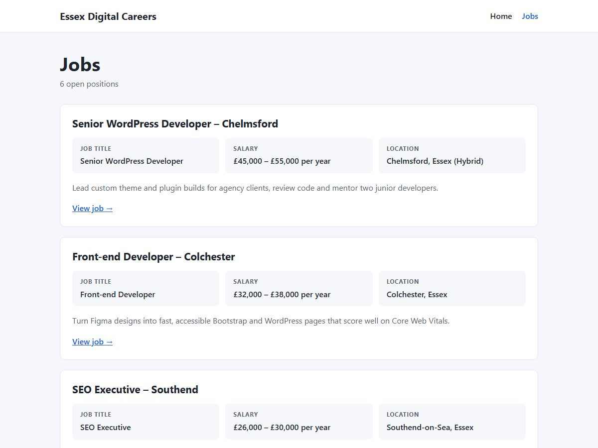

# Back-end Assessment: Jobs Board theme

A **"Jobs" custom post type** with **Job Title**, **Salary** and **Location** fields. It includes:
- a jobs **archive** at `/jobs/`;
- a **single job** view at `/jobs/{slug}/`.

It is built **without plugins**. All the code is in the `wp-content/themes/jobs-board` theme.



## Requirements checklist

| Requirement | How it is met |
| --- | --- |
| Custom post type "Jobs": add, edit, delete | `register_post_type( 'job' )` in `inc/jobs.php`. It has its own **Jobs** admin menu (All Jobs / Add New Job), full labels, and support for title, description, excerpt, featured image and revisions. Trash and permanent delete work as they do for posts. |
| Job Title, Salary, Location fields | Registered with `register_post_meta()`: sanitised, permission-checked, and available in the REST API. Edited in a **Job details** box directly under the job name. |
| No plugins | No ACF or other plugins: core APIs only (post type, post meta, meta box, nonces). |
| Archive view with all fields | `archive-job.php` at **`/jobs/`**. Every job shows its title, Job Title, Salary, Location and summary, 12 per page with pagination. |
| Single view with all fields | `single-job.php` at **`/jobs/{slug}/`**. It shows the title, posted date, all three fields and the full description. |
| Git repository | Only the theme, setup scripts and this README are tracked; see the root README. |

### Extras

- **Admin columns:** the Jobs list shows Job Title, Salary and Location columns, and Location is sortable.
- **Classic edit screen:** jobs use it so the fields are visible straight away. The block editor in WordPress 6.7+ hides meta boxes in a collapsed pane.
- **Notices:** "Job published / Job updated" replace the generic "Post …" messages.
- **Safe saving:** nonce, autosave, revision and `edit_post` checks; `sanitize_text_field()`; and an emptied field deletes its meta instead of saving an empty string.
- **SEO:** schema.org **`JobPosting`** JSON-LD on single jobs (title, description, date posted, organisation, location).
- **Permalinks:** rewrite rules are rebuilt when the theme is activated, so `/jobs/` works at once, and cleared when you switch away.
- **Escaping and i18n:** all output is escaped, and all strings are translatable (`jobs-board` text domain).

### Why there is a "Job Title" field as well as the post title

- The **post title** is the advert headline used in lists and the URL, e.g. "Senior WordPress Developer – Chelmsford".
- **Job Title** is the role itself, e.g. "Senior WordPress Developer". It is also the `title` in the JobPosting structured data.

## Project structure

```
backend-assessment/             ← WordPress root (core files are not in git)
├── README.md
├── setup/
│   ├── install.php             ← one-step local install (CLI only)
│   ├── demo-content.php        ← six sample jobs, Home page, menu (CLI only)
│   └── router.php              ← router for `php -S` local server
└── wp-content/themes/jobs-board/
    ├── style.css               ← theme header + styles
    ├── functions.php           ← supports, menu, stylesheet
    ├── inc/jobs.php            ← post type, fields, meta box, admin columns, queries, JSON-LD
    ├── archive-job.php         ← /jobs/
    ├── single-job.php          ← /jobs/{slug}/
    ├── template-parts/job-fields.php   ← Job Title / Salary / Location list
    ├── header.php / footer.php / index.php
    └── screenshot.jpg
```

## Requirements

- PHP 7.4 or newer (built and tested on PHP 8.3)
- MySQL 5.7+ or MariaDB 10.4+
- WordPress 6.4 or newer (built and tested on **7.1.4**)

## Run it locally

**Quickest:** with PHP and MySQL running, from this folder:

```bash
php setup/install.php
php -S localhost:8092 setup/router.php
```

Open <http://localhost:8092/jobs/>. The installer does the following, then prints the admin login:
- downloads WordPress;
- creates the `wpa_backend` database and `wp-config.php`;
- installs the site, activates the theme and adds six sample jobs.

Log in at <http://localhost:8092/wp-admin/> as `admin` with the printed password.
- To choose your own password, add `--admin-pass=YOUR_PASSWORD`.
- If you forget it, run the installer again with `--admin-pass=NEW_PASSWORD`.

If your MySQL isn't root with no password, add your details, e.g. `--db-user=root --db-pass=root --db-port=8889`. `--help` lists every option. Troubleshooting is in the [root README](../README.md#troubleshooting).

### Manual install (without the installer)

You need PHP and MySQL; Laragon, XAMPP and MAMP include both. WP-CLI is **not** required. WordPress core isn't committed, so add it once:

1. **Add WordPress core.** Download <https://wordpress.org/latest.zip>, unzip it, and copy everything **except its `wp-content` folder** into this project folder. In PowerShell, from this folder:
   ```powershell
   Invoke-WebRequest https://wordpress.org/latest.zip -OutFile "$env:TEMP\wordpress.zip"
   Expand-Archive "$env:TEMP\wordpress.zip" "$env:TEMP\wp-core" -Force
   Get-ChildItem "$env:TEMP\wp-core\wordpress" -Exclude wp-content | Copy-Item -Destination . -Recurse -Force
   ```
2. **Create an empty database** called `wpa_backend`, using HeidiSQL, phpMyAdmin or:
   ```powershell
   mysql -u root -e "CREATE DATABASE wpa_backend CHARACTER SET utf8mb4"
   ```
3. **Start the site** from this folder:
   ```powershell
   php -S localhost:8092 setup/router.php
   ```
4. **Install WordPress.** Open <http://localhost:8092>. The setup wizard does three things:
   - asks for the database details (name `wpa_backend`, user `root`, password empty on Laragon/XAMPP, host `127.0.0.1`);
   - writes `wp-config.php`;
   - asks for a site title and an admin account.
5. **Activate the theme:** WP Admin → Appearance → Themes → **Jobs Board** → Activate.
6. **Add the sample jobs.** In a second terminal, from this folder:
   ```powershell
   php setup/demo-content.php
   ```
   Open <http://localhost:8092/jobs/>. Or add jobs yourself under **Jobs → Add New Job**, after setting Settings → Permalinks to "Post name".

If PowerShell says `php` or `mysql` is not recognised, open Laragon's terminal (Menu → Terminal), which has both on its PATH. Or call PHP by its full path, e.g. `C:\laragon\bin\php\php-8.3.11-nts-Win32-vs16-x64\php.exe`.

### With WP-CLI (optional)

If [WP-CLI](https://make.wordpress.org/cli/handbook/guides/installing/) is installed (the `wp` command), these commands replace steps 1, 2 and 4–6:

```bash
wp core download --skip-content
wp config create --dbname=wpa_backend --dbuser=root --dbhost=127.0.0.1
wp db create
wp core install --url=http://localhost:8092 --title="Essex Digital Careers" --admin_user=admin --admin_email=you@example.com
wp theme activate jobs-board
wp eval-file setup/demo-content.php
```

`setup/demo-content.php` can be run more than once:
- It turns on "Post name" permalinks.
- It adds **six sample jobs**, but only if there are no jobs yet.
- It adds a Home page that links to the jobs list, and a Home / Jobs menu.

It never deletes anything, and it refuses to run from a browser.

## Deploy to a live WordPress site

The live site only needs the **theme**.

### 1. Upload the theme

Build a zip of the theme folder.

PowerShell:
```powershell
Compress-Archive -Path wp-content\themes\jobs-board -DestinationPath jobs-board.zip
```
macOS / Linux:
```bash
cd wp-content/themes && zip -r ../../jobs-board.zip jobs-board
```

Then upload it in one of these ways:
- **WP Admin:** Appearance → Themes → Add New Theme → Upload Theme → choose `jobs-board.zip` → Install Now → **Activate**.
- **SFTP/SSH:** copy the `jobs-board` folder to `wp-content/themes/` on the server, then activate it in Appearance → Themes. With WP-CLI on the server, `wp theme activate jobs-board` does the same.

### 2. Permalinks

Go to Settings → Permalinks → choose **Post name** → **Save Changes**.

Saving also rebuilds the rewrite rules. If `/jobs/` ever returns a 404 (for example after a migration), save this screen again.

### 3. Add jobs

1. Go to **Jobs → Add New Job**.
2. Enter the headline.
3. Fill in **Job Title**, **Salary** and **Location** in the *Job details* box.
4. Write the description. Optionally add an excerpt for the archive summary and a featured image.
5. Publish.

To edit or delete jobs, use **Jobs → All Jobs** (hover a row for Edit, Quick Edit and Trash).

### 4. Menu (optional)

Go to Appearance → Menus. In the left column, open **Jobs**, then the **View All** tab, and add **Jobs** (the archive link). Assign the menu to **Primary navigation**.

### 5. Go-live checklist

- Settings → Reading → make sure **"Discourage search engines from indexing this site"** is unticked.
- In `wp-config.php`, set `WP_DEBUG` to `false`.
- Open `/jobs/` and a single job: all three fields should show, and pagination appears once there are more than 12 jobs.
- Check a single job in Google's [Rich Results Test](https://search.google.com/test/rich-results), which should detect a *Job posting*.

## Notes

- **Where the post type lives.** Because the brief says "no plugins", the post type is in the theme. On a long-lived production site I would move `inc/jobs.php` into a small must-use plugin (`wp-content/mu-plugins/`) so jobs stay editable if the theme is ever changed. The data is not lost either way: it stays in the database, and reactivating the theme brings it back.
- **Meta keys.** The keys are `_job_title`, `_job_salary` and `_job_location`. The leading underscore keeps them out of the generic "Custom Fields" panel, so the Job details box is the only place to edit them. Over REST they are readable, and writable by users who can edit the job.
- **Salary format.** Salary is free text ("£45,000 – £55,000 per year", "£14 per hour"), so it isn't sent to Google as a structured `baseSalary`. A numeric min/max/unit trio would allow that.
