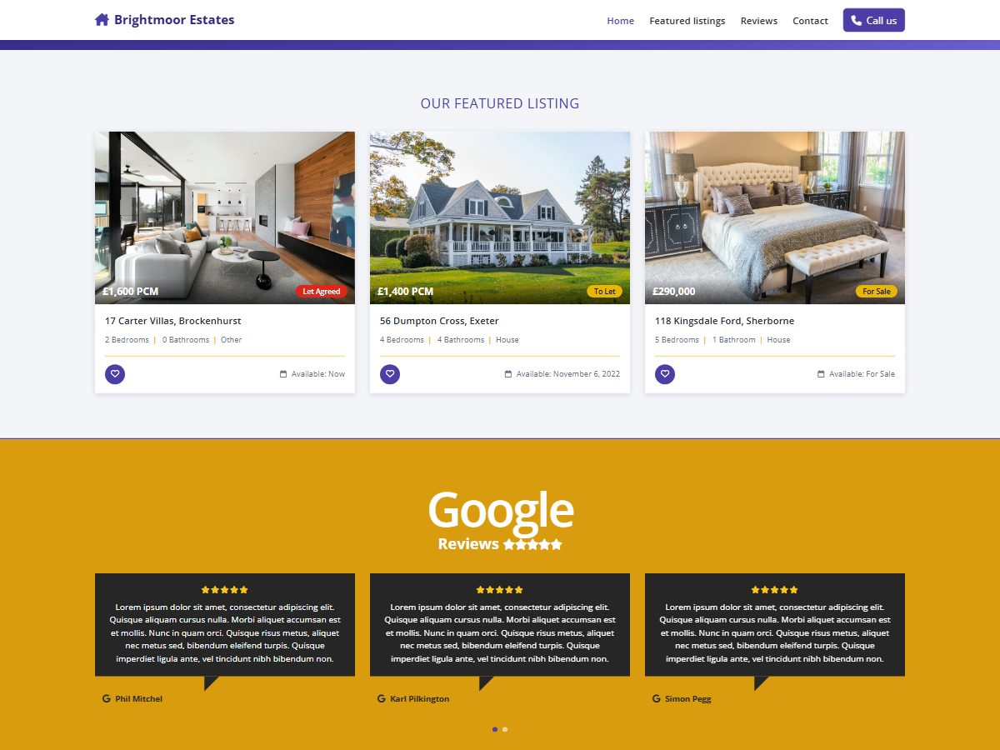

# Front-end Assessment: Estate Showcase theme

A WordPress landing page built from the two client designs:

- **Design 1:** "Our featured listing", a three-column grid of property cards.
- **Design 2:** "Google Reviews", six reviews on a three-column slider.

Everything lives in one lightweight classic theme, `wp-content/themes/estate-showcase`. It needs no plugins.



## Requirements checklist

| Requirement | How it is met |
| --- | --- |
| Built with Bootstrap 5 | Bootstrap **5.3.3** CSS and JS bundle, loaded from jsDelivr with Subresource Integrity (`functions.php`). Layout uses the Bootstrap grid, cards, buttons and carousel. |
| Standard Bootstrap navbar | `header.php` uses `navbar navbar-expand-lg` with the collapse toggler. `inc/class-estate-showcase-navwalker.php` outputs the WordPress menu as `nav-item`/`nav-link`, including dropdowns, `active` and `aria-current`. |
| Header and footer | `header.php` has a sticky navbar and a "Call us" button. `footer.php` has the brand, a footer menu, contact details and social icons. |
| Responsive on all devices | The listings show 1, 2 or 3 per row. The slider regroups reviews to **1 per slide on phones, 2 on tablets and 3 on desktop**, and rebuilds the dots to match. Checked at 390, 834 and 1280 px with no horizontal scrolling. |
| Font Awesome icons | Font Awesome **6.5.2** (cdnjs, with SRI): heart, calendar, stars, Google "G", phone, envelope, location and social icons. |
| Open Sans Google font | Weights 300/400/600/700 with `display=swap` and `preconnect` hints. |
| SEO friendly | See [SEO](#seo) below. |

## SEO

- **Headings:** one `<h1>` (the page title), section `<h2>`s, and an `<h3>` for each property.
- **Semantic markup:** `header`/`nav`/`main`/`section`/`article`/`figure`/`footer`, `blockquote` + `figcaption` for reviews, and a skip link.
- **Title:** `<title>` comes from WordPress (`title-tag` support). Core also adds the canonical link and robots meta.
- **Description:** the meta description is the page's **excerpt**, so it can be edited in WP Admin. If there is no excerpt it falls back to the opening words, then the tagline.
- **Social tags:** Open Graph and Twitter card tags.
- **Structured data:** JSON-LD with a `RealEstateAgent` and an `ItemList` of `RealEstateListing`s (price, currency, image, URL).
- **Images:** descriptive `alt` text, explicit `width`/`height` (no layout shift), and `loading="lazy"`.
- **Plugin aware:** if Yoast, Rank Math, AIOSEO, SEOPress or The SEO Framework is active, the theme's meta/social tags step aside so nothing is printed twice.

## Project structure

```
frontend-assessment/            ← WordPress root (core files are not in git)
├── README.md
├── setup/
│   ├── demo-content.php        ← creates the Home page + menus (CLI only)
│   └── router.php              ← router for `php -S` local server
└── wp-content/themes/estate-showcase/
    ├── style.css               ← theme header + all custom styles
    ├── functions.php           ← supports, menus, assets (CDN + SRI)
    ├── header.php / footer.php
    ├── index.php               ← fallback for other pages/posts/404
    ├── page-templates/featured-listings.php   ← "Featured Listings" page template
    ├── template-parts/
    │   ├── section-featured-listings.php      ← Design 1
    │   ├── property-card.php
    │   ├── section-reviews.php                ← Design 2
    │   └── review-card.php
    ├── inc/
    │   ├── class-estate-showcase-navwalker.php
    │   ├── content.php         ← listings, reviews and contact data (+ filters)
    │   └── seo.php
    ├── assets/js/theme.js      ← responsive slider grouping + favourite toggle
    ├── assets/images/          ← property photos (Unsplash licence)
    └── screenshot.jpg
```

## Requirements

- PHP 7.4 or newer (built and tested on PHP 8.3)
- MySQL 5.7+ or MariaDB 10.4+
- WordPress 6.4 or newer (built and tested on **7.1.4**)

## Run it locally

WordPress core is not committed. Add it once, then install:

1. **Get WordPress core** into this folder. Use WP-CLI `wp core download --skip-content`, or unzip <https://wordpress.org/latest.zip> here **without** overwriting `wp-content/themes/estate-showcase`.
2. **Create a database**, e.g. `wpa_frontend` (utf8mb4).
3. **Create `wp-config.php`.** With WP-CLI: `wp config create --dbname=wpa_frontend --dbuser=root --dbhost=127.0.0.1`. Otherwise copy `wp-config-sample.php` and fill in the database details.
4. **Install WordPress:**
   ```bash
   wp core install --url=http://localhost:8091 --title="Brightmoor Estates" --admin_user=admin --admin_email=you@example.com
   ```
   Or open `/wp-admin/install.php` in the browser.
5. **Activate the theme and add the demo page and menus:**
   ```bash
   wp theme activate estate-showcase
   wp eval-file setup/demo-content.php     # or: php setup/demo-content.php
   ```
6. **Serve it:**
   ```bash
   php -S localhost:8091 setup/router.php
   ```
   Then open <http://localhost:8091>. With Laragon, XAMPP or MAMP you can point a virtual host at this folder instead and use that URL in step 4.

`setup/demo-content.php` can be run more than once:
- It sets the site title and tagline.
- It creates a **Home** page with the *Featured Listings* template and makes it the front page.
- It turns on "Post name" permalinks and builds the menu for the Primary and Footer locations.

It never deletes anything, and it refuses to run from a browser.

## Deploy to a live WordPress site

The live site only needs the **theme**.

### 1. Upload the theme

Build a zip of the theme folder.

PowerShell:
```powershell
Compress-Archive -Path wp-content\themes\estate-showcase -DestinationPath estate-showcase.zip
```
macOS / Linux:
```bash
cd wp-content/themes && zip -r ../../estate-showcase.zip estate-showcase
```

Then upload it in one of these ways:
- **WP Admin:** Appearance → Themes → Add New Theme → Upload Theme → choose `estate-showcase.zip` → Install Now → **Activate**.
- **SFTP/SSH:** copy the `estate-showcase` folder to `wp-content/themes/` on the server, then activate it in Appearance → Themes, or run `wp theme activate estate-showcase`.

### 2. Create the landing page

1. Go to Pages → Add New Page.
2. **Title:** this becomes the page's `<h1>`, e.g. "Homes to rent and buy across the South of England".
3. **Content:** one or two sentences of intro text.
4. **Excerpt:** the meta description (about 150–160 characters).
5. **Template:** in Page → Template, choose **Featured Listings**. Publish.
6. Go to Settings → Reading → "Your homepage displays" → **A static page** → choose that page.

### 3. Menus

Go to Appearance → Menus and create a menu with these Custom Links:

| Label | URL |
| --- | --- |
| Home | `/` |
| Featured listings | `/#featured` |
| Reviews | `/#reviews` |
| Contact | `/#contact` |

Tick **Primary navigation** and **Footer links**, then save.

### 4. Go-live checklist

- Settings → Permalinks → **Post name** → Save.
- Settings → Reading → untick **"Discourage search engines from indexing this site"**. Local installs have it ticked.
- In `wp-config.php`, set `WP_DEBUG` to `false`.
- Replace the placeholder contact details, social links, listings and reviews (see below).
- Check the page:
  - the menu collapses below 992 px;
  - the slider shows 3 reviews per slide on desktop, 2 on tablets and 1 on phones;
  - View Source shows one `<h1>`, the meta description and the JSON-LD.
- Run Google's [Rich Results Test](https://search.google.com/test/rich-results) and [PageSpeed Insights](https://pagespeed.web.dev/).

WP-CLI on the server can do the page and menu steps with `wp eval-file setup/demo-content.php` (upload `setup/` first). That script **also renames the site title and tagline** to the demo values, so on a live site prefer the manual steps.

## Editing the content

Listings, reviews and contact details are plain PHP arrays in `inc/content.php`. Add property photos to `assets/images/`, or use full image URLs.

To change them without editing the theme, use the filters from a child theme or a small plugin:

```php
add_filter( 'estate_showcase_reviews', function ( $reviews ) {
	$reviews[] = array( 'author' => 'Jane Doe', 'rating' => 5, 'text' => 'Fantastic service from start to finish.' );
	return $reviews;
} );
```

| Filter | Data |
| --- | --- |
| `estate_showcase_properties` | Listings: address, price, numeric amount, status (`let-agreed`, `to-let`, `for-sale`), bedrooms, bathrooms, type, availability, image, alt text |
| `estate_showcase_reviews` | Reviews: author, rating (0–5), text |
| `estate_showcase_contact` | Address, phone, email, social links |

## Notes

- **Slider.** Bootstrap's carousel moves one `.carousel-item` at a time. The server renders 3 reviews per slide, so the slider works and every review is in the HTML for search engines. `theme.js` then regroups them for the current breakpoint. Autoplay is off for visitors who prefer reduced motion.
- **Reviews.** The review text is the client's lorem-ipsum placeholder. No `Review` schema is printed: Google ignores self-hosted reviews of your own business, and placeholder reviews shouldn't be marked up anyway.
- **Data source.** Listings and reviews are theme data, which keeps the front-end task focused. A production build would load them from a "Property" post type and the Google Places API.
- **CDN assets.** Bootstrap and Font Awesome are pinned to exact versions with SRI hashes, so a tampered CDN file won't run. To self-host, swap the URLs in `estate_showcase_cdn_assets()`.
- **Grammar fix.** Counts use proper plurals ("1 Bathroom"), where the mock-up shows "1 Bathrooms".
